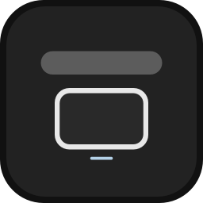
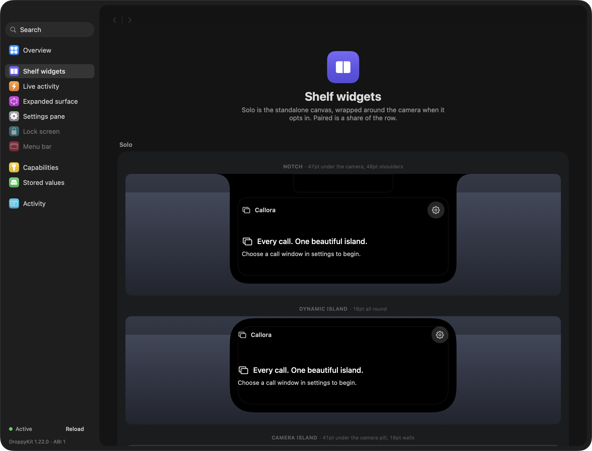
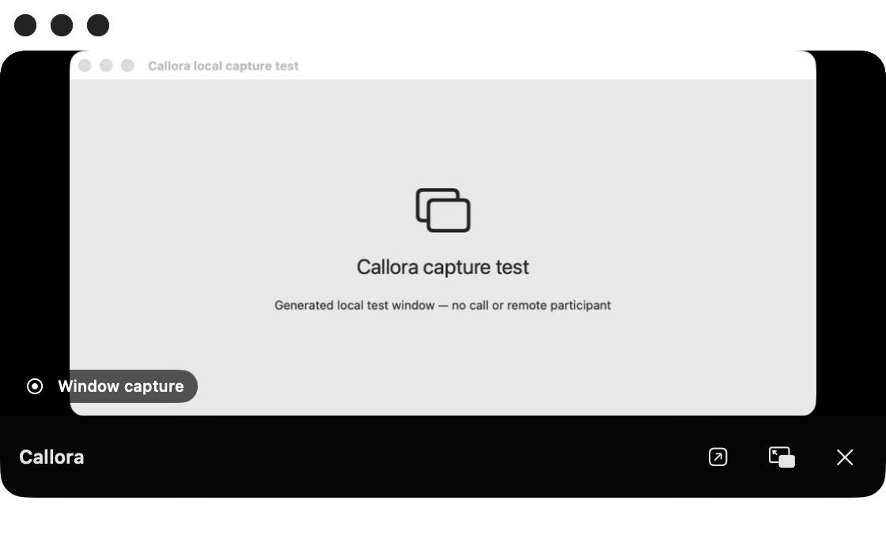

# Callora

**Every call. One beautiful island.**

Callora brings a selected application window into Droppy's notch and a native floating preview. Keep the call in its original app, move its picture beside your work, then dock it back.

**Development build, version 0.1.0.** Window capture and native panel mechanics have been tested on macOS 26. A real calling application's complete lifecycle has not yet been validated. This is not a verified public release or a claim of universal calling support. See [verification](docs/VERIFICATION.md) and [remaining work](docs/ROADMAP.md).



*Real SwiftUI surfaces rendered by DroppyKit's harness, showing the unconfigured state. These are not screenshots of an active call.*

## What works

- A real `.droplet` dynamic bundle linked against Droppy's resilient SDK framework.
- Compact Live Activity and a shelf widget on notch, island and camera-island layouts.
- Explicit selection of an application window using ScreenCaptureKit, without audio capture.
- Normalized crop controls and 10, 15 or 30 fps preview settings; resize tracking while capture is visible.
- A movable, resizable, nonactivating native `NSPanel`, with aspect constraint, opacity, always-on-top, saved position and edge snapping.
- Detach button or downward drag; dock button, drag near the screen's top center, or a user-assigned shortcut.
- Five presentation layouts: minimal, glass, controls, compact and audio only.
- Preview visibility and call lifecycle are separate. Closing or hiding the panel does not hang up.
- Capture pauses when no preview is visible and stops on source loss, app exit, sleep or deactivation.
- Optional experimental detection from accessible call controls. App launch, window title and microphone use never confirm a call.

## Compatibility

macOS 14+, Swift 6.2+, and a Droppy host embedding **DroppyKit API 1.22.0 or newer**. The manifest's base host requirement is Droppy 15.3.0, but this does not override the SDK API handshake.

**The current stable Playground download (1.0.29) embeds SDK 1.20.1 and refuses this bundle.** This was observed in its loader log on 5 November 2026. Use a newer compatible Playground/host when available. Do not lower `kit.minAPI`: the binary uses 1.22.0 symbols.

| Provider | Automatic detection | Video | Call controls |
|---|---|---|---|
| Zoom, FaceTime, Teams | Experimental English AX heuristics, off by default | Explicit window capture | Open original app |
| Meet / other calls in Chrome, Safari, Edge, Brave | Experimental accessible call controls in visible browser content; no tab identity guarantee | Explicit browser-window capture | Open original app |
| Discord, WhatsApp, Telegram, Slack, Webex, Signal | Manual association | Explicit window capture | Open original app |
| Other applications | Manual association | Explicit window capture | Open original app |

Incoming calls, caller identity, remote video streams, microphone/camera state, answer, decline and hang-up are **not advertised as supported**. The timer measures time since detection or manual association; it may differ from the actual call duration. Callora never substitutes your webcam for a participant. Full [feasibility and capability matrix](docs/FEASIBILITY.md).

## Install a local development build

1. Build using the commands below, or use the development bundle delivered with this checkout.
2. In a compatible Droppy host, open **Settings → Store → Local droplets** and select `.build/Callora.droplet`. Approve the specific local build when Droppy asks; local builds are not Store signed.
3. Enable Callora and add its shelf widget if necessary.
4. Open Callora's settings. Allow **Screen Recording** for the host application, then click **Refresh sources** and **Use window** beside the intended call window.
5. Open the shelf, then detach the preview. Hide it to stop capture; use **Forget session** to clear a manual association without affecting the source call.

A compatible free [Droppy Playground](https://getdroppy.app/download/playground) can load unsigned bundles, but verify its embedded API first. The downloaded 1.0.29 build cannot load this project.

## Build and test

```sh
git clone https://github.com/Nicolasdellim/callora-droplet.git
cd callora-droplet
git clone --branch v1.22.0 --depth 1 https://gitlab.com/droppyformac1/droppykit.git ../droppykit
export PATH="$PWD/../droppykit/Scripts:$PATH"
swift test
droppykit build                        # universal arm64 + x86_64
droppykit validate --no-submission      # GitHub layout includes tests and docs
droppykit run -- --shots ./shots --report ./shots/report.json
```

Never ship a library produced by a plain `swift build`. Only the official build script links correctly against the framework in the host. `swift test` and the harness use SwiftPM for development only.

Run `droppykit agent` after cloning to generate machine-local agent configuration. No helper app, server, account sign-in, camera access or microphone access is needed.

The opt-in capture integration test creates **its own labeled local source window**, captures it, opens/resizes a native preview, and verifies cleanup. It does not start a call. It runs only with an existing Screen Recording grant:

```sh
CALLORA_CAPTURE_TEST=1 swift test
```



*Actual integration-test screenshot: Callora's native floating view displaying its generated local test source. No live call or remote participant is shown.*

## Privacy

Frames stay in memory on the Mac; no recording, transcription, telemetry, file-backed frame cache or network upload. Screen Recording is used only for the chosen preview window. Accessibility is optional and only used for opt-in experimental call detection. Requests go through the host from settings. No audio capture or device changes occur. Source selections and participant information are not persisted. Local presentation preferences are scoped to this droplet through the host.

Capture is visibly labeled **Window capture**. The OS capture indicator also applies. A selected window may contain local and remote tiles, screen shares and app chrome; crop deliberately before presenting it elsewhere.

## Architecture

`CalloraDroplet` owns session selection, host lifecycle and capture visibility. `CallModel` contains a constrained state machine, capability set, crop model and detection reducer. `CallDetectionEngine` scans bounded AX trees off the main thread using provider descriptors. `VideoCaptureService` owns a single silent SCStream and tracks source resizing. `VideoSurface` renders sample buffers directly in an AVSampleBufferDisplayLayer. `FloatingWindowController` owns an actual NSPanel. Views use Droppy design tokens and the host's settings components.

All host calls are capability gated. All observers, scans, shortcuts, panels and capture tasks have teardown paths. Cross-window motion uses a native frame animation from the actual preview rectangle, with Reduce Motion fallback; it does not claim cross-window matched geometry.

## Troubleshooting

- **API too new:** update the host to one with SDK 1.22.0+. The current stable Playground 1.0.29 is too old.
- **No source windows:** allow Screen Recording for the actual host, relaunch it if macOS requests that, reopen a source window, refresh permissions and sources.
- **Blank/frozen preview:** protected, minimized, hidden and inactive-tab content can be unavailable. Restore the source, then select it again. No protected-content bypass exists.
- **A call is not detected:** use manual window selection. English UI controls may not be exposed or may have changed. Detection is experimental and off by default.
- **No mute or hang-up buttons:** those integrations are not verified; use **Open calling application**.
- **No compact activity:** another host activity may own the seat. Persistent participation is optional in settings.
- **Window geometry changed:** the service refreshes source geometry every four seconds while visible. Re-select after replacing the call window.
- **Unsigned-build prompt:** local Droppy builds require explicit host trust. Do not disable host verification.

## Contributing, distribution and credits

See [CONTRIBUTING.md](CONTRIBUTING.md), [release checklist](docs/ROADMAP.md), and [Store submission](docs/STORE_SUBMISSION.md). The Store has a restricted package layout and its maintainer supplies the final icon; the GitHub development repository deliberately contains tests, documentation and original custom icon concepts.

MIT license for Callora code and original artwork. DroppyKit is a separate MIT-licensed dependency from [droppyformac1/droppykit](https://gitlab.com/droppyformac1/droppykit). Droppy is a product of its respective owner; Callora is an independent community project.
